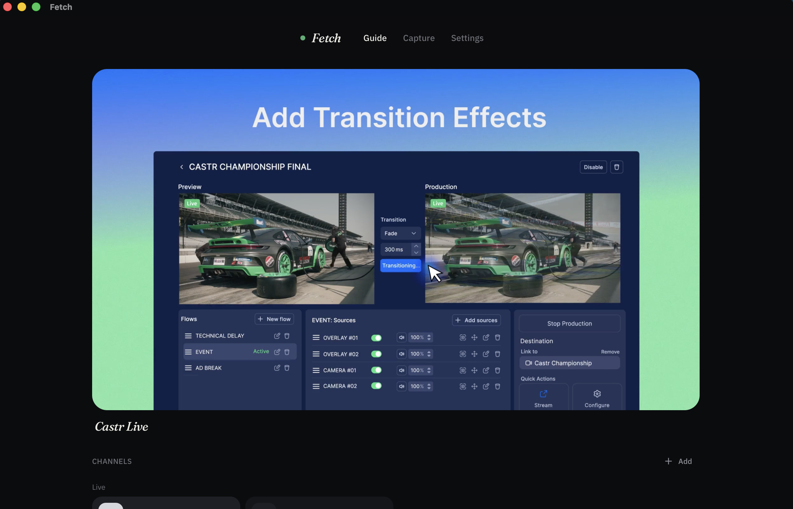

# Fetch

I built Fetch because I got tired of watching streams in my browser and seeing ads pop up everywhere.
Fetch is a macOS desktop app with a simple interface and a video player.
Paste a video link, and Fetch retrieves and streams it for you.
Say goodbye to those ads.

[Download Fetch for macOS](https://github.com/rexchao1/Fetch/releases/latest/download/Fetch.dmg)

Fetch runs on Macs with Apple silicon.
When you first open Fetch, macOS may warn that it cannot check the app for malware.
Open **System Settings**, go to **Privacy & Security**, and click **Open Anyway**.

## Background

Jellyfin is an open-source media server that you host to organize movies, shows, and live channels on your own machine.
For live TV, Jellyfin uses an M3U playlist containing channel names and stream URLs.
A channel URL often points to an `HLS` (HTTP Live Streaming) playlist file.
HLS is a streaming format that splits video into short segments and gives the player a text-based playlist of upcoming segments to fetch.
These playlists are stored in `.m3u8` files.
A master playlist lists available video quality levels; a media playlist points to the video segments.
For a live feed, segment names can change over time.

When you stream a video in a browser, the page requests the stream's playlist URL.
The playlist URL may be accessible even without authorization.

The hard part is authorization.
Many sites will only serve the video if the request looks like it came from their own player.
They may check the request's `Host` header first.
They may also check the `Referer` header, which identifies the page that supposedly gave them the URL.
The site may also set a cookie after the page loads.
Sites also commonly sign the playlist URL with a token that may expire in ten or fifteen minutes.

Jellyfin needs a public, stable URL.
Paste one of these signed playlist URLs into Jellyfin, and it may work once.
After the token expires, Jellyfin gets a `403` and has no way to return to the page to get a new one.
Fetch acts as an intermediary between Jellyfin and the origin.
Jellyfin talks only to Fetch at a stable URL that does not change.
Fetch talks to the origin, with the headers and cookies that a browser would send.
It rewrites the playlist so every segment is fetched through Fetch too.

Fetch does not need to imitate a browser.
When a token is about to expire, Fetch gets a fresh playlist before Jellyfin notices.

## Using Fetch

The **Guide** shows the channel lineup.
Select a channel to play it, or add a playlist URL if you already have one.

If you only have a website that plays video in a browser, open the **Capture** tab, paste its URL, and start sniffing.
Sniffing lets Fetch find an HLS `.m3u8` playlist.
Sniffing checks the website's network requests and captures the playlist and its authorization data when available.
Sniffing runs Google Chrome in the background, so Chrome must be installed.

To connect Jellyfin, open **Settings**, copy the link, and add it in Jellyfin as an M3U tuner.
The M3U list stays live, so while Fetch is open, channels you add later appear in Jellyfin on its next refresh.
For now, Jellyfin must run on this Mac.

Fetch is designed to run in the background.
Close the window, and the path is gone. That is intentional.
Nothing remains to consume your CPU.
