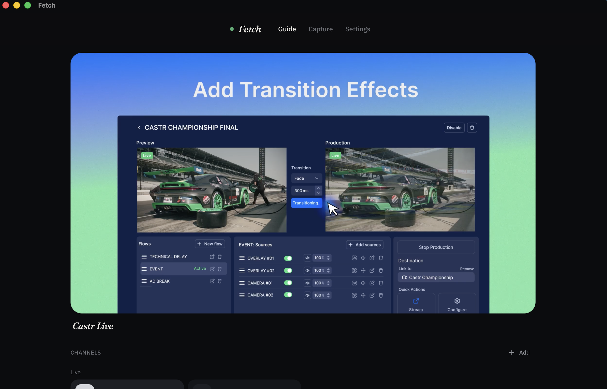

# Fetch

I built Fetch because I got tired of streaming in my browser and seeing ads pop up everywhere.
Fetch is a macOS desktop app with a simple interface and a video player.
Provide a video URL, and Fetch retrieves and streams it for you. Say goodbye to those ads.

[Download Fetch for macOS](https://github.com/rexchao1/Fetch/releases/latest/download/Fetch.dmg)

Fetch runs on Macs with Apple silicon.
When you first open Fetch, macOS may warn that it cannot check the app for malware.
Open System Settings, go to Privacy & Security, and click Open Anyway.

## Background

Jellyfin is an open-source media server you run yourself to manage movies, shows, and live channels on your own machine.
For live TV, Jellyfin uses an M3U playlist that lists channel names and their URLs.
Each URL often points to an HLS (HTTP Live Streaming) playlist.
HLS is a streaming format that splits video into small files and gives the player a text list of what to fetch next. This list is stored in a `.m3u8` file.
A master playlist points to available quality levels, while a media playlist points to the video chunks. On a live feed, chunk names change over time.

When you stream a video in a browser, it requests the stream's `.m3u8` URL.
The URL can be publicly accessible.

The hard part is authorization. Many sites will only serve the video if the request looks like it came from their own player.
They may check the request's Host header first.
They may also check the Referer header, which identifies the page that supposedly gave them the URL.
The site may set a cookie after the page loads. Sites also commonly sign the playlist URL with a token that may expire in ten or fifteen minutes.

Jellyfin needs a public, stable URL. Paste one of these signed playlist URLs into Jellyfin and it may work once.
After the token expires, Jellyfin gets a 403 and has no way to return to the page to get a new one.
Fetch sits between Jellyfin and the origin. Jellyfin only ever talks to Fetch at a stable URL that does not rotate.
Fetch talks to the origin with the headers and cookies that a browser would send. It rewrites the playlist so every chunk comes through Fetch too.

Fetch does not need to impersonate a browser.
When a token is about to expire, Fetch gets a fresh playlist before Jellyfin notices.

## Using Fetch

The Guide displays the channel lineup. Select a channel to play it, or add a playlist URL if you already have one.

If you only have a website that plays in a browser, open the Capture tab, paste the page URL, and start sniffing.
Sniffing is how Fetch finds the `.m3u8` playlist. It checks the website's network requests and captures the playlist and any authorization data included with it.
Sniffing runs your installed copy of Google Chrome in the background, so Google Chrome must be installed.

To connect Jellyfin, open Settings, copy the link, and add it in Jellyfin as an M3U tuner.
The M3U list stays live, so channels you add later appear in Jellyfin on its next refresh while Fetch is open.
For now, Jellyfin must run on the same Mac.

Fetch is designed to run in the background. Close the window and the path is gone; that is intentional. Nothing remains to consume your CPU.
